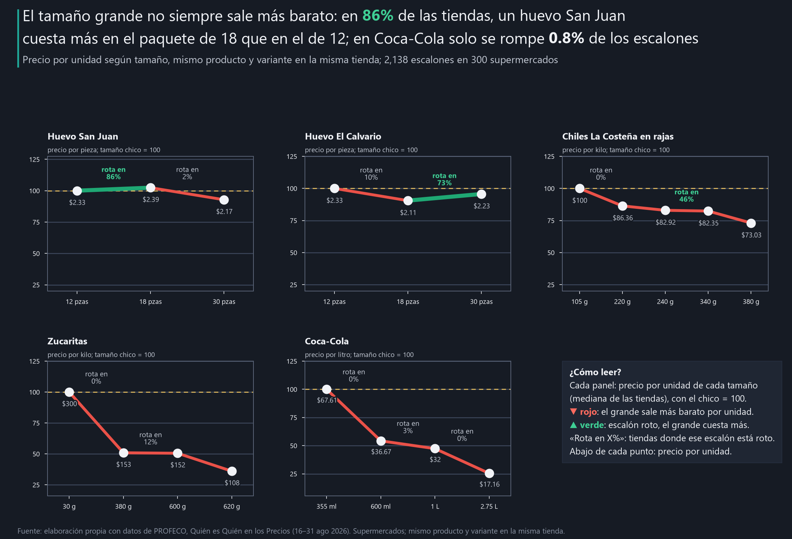

# ¿El tamaño grande siempre sale más barato?

**Objetivo.** Mostrar a dueños de negocio y a equipos de revenue management y category management de consumo y retail en México cómo se comporta en el anaquel el precio por tamaño de marcas líderes, y dónde el tamaño grande deja de ahorrar.

**En la misma tienda, ¿el precio por litro, kilo o pieza baja al subir el tamaño en marcas líderes?**

## El hallazgo principal

**El cartón de 18 huevos San Juan sale más caro por huevo que el de 12 en las 6 cadenas que lo venden.** Pagas $1.05 de más por cartón (+2.4% por huevo) y pasa en 94.6% a 100% de las tiendas de cada cadena. Si seis competidores repiten lo mismo, no parece decisión de una tienda: parece venir de la lista de precios.

Medido por tienda: **En 86% de las tiendas (IC90 82–90%), un huevo San Juan cuesta más en el paquete de 18 que en el de 12; en Coca-Cola, la escalera se rompe en solo 0.8% de los escalones.** En las cinco marcas analizadas, 17% de los 2,138 escalones están rotos: el tamaño grande cuesta más por unidad que el chico en la misma tienda. La ruptura no se reparte: cada marca la concentra en un escalón.



Escalón = un tamaño contra el siguiente más grande que tiene la tienda, por litro, kilo o pieza. Escalón roto = el tamaño grande cuesta más por unidad. IC90 = rango probable, por bootstrap de tiendas y municipios. Reporte interactivo: https://ernestrr.github.io/mexico-arquitectura-precio-tamano/

## Tres hallazgos de apoyo

1. **Cada marca rompe su escalera en un escalón.** Huevo El Calvario de 18 a 30 piezas: roto en 73% de las tiendas (IC90 68–79%). Chiles La Costeña en rajas de 240 a 340 g: 46% (IC90 37–54%). Zucaritas de 380 a 600 g: 12%. En los otros escalones la escalera funciona: en Coca-Cola, el litro baja −44% de lata a 600 ml y −46% de 1 L a 2.75 L.
2. **La ruptura viene del producto, no de la cadena.** El escalón de 12 a 18 huevos San Juan está roto en 95% a 100% de las tiendas de cada una de las 6 cadenas con datos. Por cadena, el % de escalones rotos va de 0% a 35%, pero sobre todo por la mezcla de productos que vende cada una: con la misma mezcla, ninguna se aleja más de 16 puntos de lo esperado.
3. **Son pocos pesos por paquete, pero rompen una promesa.** Donde la escalera está rota, el paquete de 18 huevos San Juan cuesta $1.05 más que 18 huevos al precio por pieza del de 12, y el de 30 huevos El Calvario $3.33 más que 30 al precio del de 18. Típicamente, un huevo San Juan cuesta $2.33 en el paquete de 12, $2.39 en el de 18 y $2.17 en el de 30.

**Lo que no resultó sólido.** El % roto por marca mezcla escalones muy distintos y su rango probable es amplio (huevo San Juan: 44%, IC90 1–85%); por eso las cifras principales son por escalón. La cadena con más rupturas (Chedraui Selecto, 35%) tiene solo 3 tiendas, y Superissste no tiene ninguna ruptura pero sí muchos escalones planos (descuento menor a 5%). En chiles La Costeña, el resultado depende de qué escalones se cuentan: solo con tamaños contiguos, el % roto sube de 13% a casi el doble.

## Qué significa para el negocio y qué hacer

Aplica a los supermercados que monitorea PROFECO, no a todo el mercado. Solo precio al consumidor: no se observan costos de empaque ni ventas por tamaño.

**Revenue management de una marca**
- **Audite el escalón, no la marca.** La ruptura se concentra en un paso: 12 a 18 huevos (86% de las tiendas), 18 a 30 (73%), 240 a 340 g de rajas (46%). Revise el precio de lista de esos tamaños.
- **Si la ruptura está en todas las cadenas, apunta a su lista de precios.** El escalón de 12 a 18 huevos San Juan está roto en 95–100% de las tiendas de cada cadena.
- **Copie la disciplina de Coca-Cola:** cada tamaño más grande baja con claridad el precio por litro, y solo 0.8% de los escalones se rompe.

**Category management de una cadena**
- **Revise el anaquel con el precio por unidad.** Un escalón roto hace que el cliente informado compre el tamaño chico, o que el que no compara pague de más.
- **Marque los escalones planos y rotos en su sistema de precios.** 9% de los escalones son planos (descuento menor a 5%) y 17% están rotos.
- **Use la etiqueta de precio por unidad como herramienta, no como trámite:** es la que hace visible la escalera.

**Analista comercial**
- **Defina la variante antes de comparar tamaños.** Bimbo y los yoghurts parecen tener 3 tamaños, pero mezclan pan tostado con pan de caja y vaso con bebible.
- **Reporte por escalón y por tamaños contiguos.** El promedio por marca mezcla escalones sanos con rotos y su rango probable es muy amplio.

## Cómo se hizo (breve)

- Precios de tienda (mediana de la quincena) de supermercados monitoreados por PROFECO del 16 al 31 de agosto de 2026.
- Selección: escaleras con 3 tamaños o más de la misma variante en 100 tiendas o más: Coca-Cola regular, huevo blanco San Juan y El Calvario, Zucaritas y chiles jalapeños en rajas La Costeña.
- Escalones chico → grande en la misma tienda (motor `pares.tamanos`), por litro, kilo o pieza: 2,138 escalones en 300 supermercados de 63 municipios.
- % de escalones rotos con IC90 por bootstrap de tiendas y municipios (500 réplicas, semilla 2026); desglose por escalón, marca y cadena.

## Limitaciones

- **Universo:** solo tiendas monitoreadas por PROFECO; no es una muestra representativa de todos los establecimientos.
- **Periodo:** una quincena (16–31 ago 2026); una promoción en un tamaño puede romper un escalón por unos días.
- **Selección:** cinco escaleras de marcas con cobertura amplia; no describe todas las marcas del anaquel.
- **Envases distintos:** en Coca-Cola la lata y la botella son envases distintos de la misma bebida.
- **Causalidad:** el análisis no dice por qué una escalera se rompe (costos, promociones o precios de lista).

## Método

**00 · Datos y selección.** Tabla común `precio_tienda_sku` unida a `tiendas` y `sku_catalogo`. Se revisaron diez escaleras
candidatas (lista en `data/metadata/seleccion_marcas.csv`). Entran las que tienen 3 tamaños o más de la misma variante y 100 tiendas
o más con al menos 3 tamaños. No entran: pan Bimbo y yoghurt (mezclan productos distintos), café Nescafé (2 tamaños por variante),
agua Ciel (74 tiendas), galletas Saladitas y caldo Knorr (casi ninguna tienda con los tres tamaños). Presentaciones
ambiguas fuera. Solo Coca-Cola tiene empresa propietaria verificada; para las demás no se menciona la empresa.

**01 · Escalera por marca.** Cambio del precio por unidad en cada escalón contiguo (mediana de las tiendas).

**02 · Rupturas.** % de escalones con el tamaño grande más caro por unidad; «plano» = descuento menor a 5%. IC90 por bootstrap de
dos vías (escalones y municipios). Sensibilidad del total: entre 16.6% y 20.8% (solo contiguos, sin
extremos, ruptura mayor a 1%); huevo San Juan entre 42.1% y 44.6%.

**03 · Cadenas y formatos.** % roto por formato con 20 escalones o más; comparación contra lo esperado con la misma mezcla de
escalones.

**04 · Qué revisar.** Sobreprecio por empaque = (precio por unidad del grande − del chico) × tamaño del grande, en las tiendas con el
escalón roto.

**05 · Visualizaciones.** Gráficas, versiones para publicar y reporte interactivo.

## Fuentes

Todas las gráficas y cifras son **elaboración propia con datos de PROFECO**. Convención de color por signo: verde = valor positivo (▲); rojo = valor negativo (▼). Dorado marca referencias.

- **The Coca-Cola Company**, Form 10-K 2025 (propiedad de la marca Coca-Cola): https://www.sec.gov/Archives/edgar/data/21344/000162828026010047/ko-20251231.htm
- **PROFECO**, Quién es Quién en los Precios: archivo `08-2026_Q2.csv` (16–31 ago 2026). **URL oficial del programa:** https://qqp.profeco.gob.mx/

## Estructura y reproducción

```
mexico-arquitectura-precio-tamano/
├── notebooks/        00 datos y selección · 01 escalera por marca · 02 rupturas
│                     03 cadenas y formatos · 04 qué revisar · 05 visualizaciones
├── config.yaml       objetivo, preguntas y textos del README y del reporte
├── src/              entorno.py, escalera.py (escalones por tamaño), graficas.py, reporte.py
├── data/processed/   escalones por tienda, rupturas por marca, escalón y cadena (CSV) y resultados.json
├── data/metadata/    parametros.json, manifiesto_insumos.json, seleccion_marcas.csv
├── outputs/charts/   gráficas PNG (la principal también en SVG)
├── outputs/social/   versiones de 1280×720 y 1080×1350
├── docs/index.html   reporte interactivo autocontenido
├── build_notebooks.py
└── verify_project.py
```

```powershell
python -m pip install -r requirements.txt
python build_notebooks.py
$env:OMP_NUM_THREADS = 1; $env:OPENBLAS_NUM_THREADS = 1; $env:MKL_NUM_THREADS = 1
foreach ($n in Get-ChildItem notebooks/0*.ipynb) {
  python -m jupyter nbconvert --to notebook --execute --inplace --ExecutePreprocessor.timeout=1800 $n.FullName
}
python verify_project.py
```

`verify_project.py` recalcula las cifras clave solo con pandas y numpy a partir de los precios originales y comprueba que
coinciden con este README.

